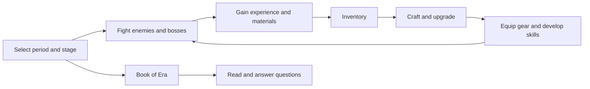

# Era Odyssey

**A 2D idle combat game about Earth's geological history.** Era Odyssey was developed by a high school team for a learning technology competition. Players travel through geological periods, fight creatures, collect materials, craft and upgrade equipment, and learn through an in-game book and timed questions.

The game ran successfully during its original presentation. This repository is an archive of source code and selected assets, not a complete Unity project that can be opened directly. The full project was too large for the team's Git workflow at the time, so it was stored on Google Drive and linked from the original `readme.txt`.

[Full project archive on Google Drive](https://drive.google.com/drive/folders/16LznbdzYvz0Czip6VU_nDyZi0XOLzPTN?usp=sharing) | [Companion website repository](https://github.com/Jakkarin-Promsee/Era-Odyssey) | [Website download page](https://github.com/Jakkarin-Promsee/Era-Odyssey/blob/main/assets/Play.html)

## Game systems

| System | Player experience | Entry points |
| --- | --- | --- |
| Periods and stages | Select stages in the Cambrian, Ordovician, and Silurian periods; backgrounds and enemies change with the period. | [`GameController`](1.Combat/New%20Scripts/GamePlayScript/GameController.cs), [`IteeSpawner`](1.Combat/New%20Scripts/GamePlayScript/IteeSpawner.cs) |
| Idle combat | The player attacks, uses skills, takes damage, and gains experience; enemies can apply or receive elemental effects and drop items. | [`PlayerMainController`](1.Combat/New%20Scripts/GamePlayScript/PlayerMainController.cs), [`EnemyMainSystem`](1.Combat/New%20Scripts/GamePlayScript/EnemyMainSystem.cs) |
| Enemies and bosses | Regular enemies, mini-bosses, and bosses are spawned in stage-based rounds. | [`IteeSpawner`](1.Combat/New%20Scripts/GamePlayScript/IteeSpawner.cs), [`EnemyMainSystem`](1.Combat/New%20Scripts/GamePlayScript/EnemyMainSystem.cs) |
| Inventory and crafting | Collect materials from enemies and spend two material types to craft or upgrade weapons and armor. | [`InventoryAllItemSystem`](1.Inventory/Scripts/Inventory%20Script/InventoryAllItemSystem.cs), [`PopUPInformationForCraft`](1.Inventory/PopUPInformation/PopUPInformationForCraft.cs) |
| Equipment | Equip two weapons and four armor pieces; equipment values contribute to combat calculations. | [`EquipmentSystem`](1.Inventory/EquipmentSystem.cs), [`PlayerMainController`](1.Combat/New%20Scripts/GamePlayScript/PlayerMainController.cs) |
| Elemental skills | Fire, Water, Frost, and Earth skills have levels, cooldowns, and element-specific effects. | [`SkillAllSystem`](1.Combat/New%20Scripts/SkillAllSystem.cs), [`Skill/`](1.Combat/New%20Scripts/Skill), [`SlotSkill/`](1.Combat/New%20Scripts/SlotSkill) |
| Educational content | The Book of Era presents reading material; a timed true/false mini-game tests the player. | [`SelectCH`](1.BookOfEra/SelectCH.cs), [`ReadBook`](1.BookOfEra/ReadBook.cs), [`MiniGame`](1.BookOfEra/MiniGame.cs) |
| Persistence | Progress, items, equipment, and skills are serialized as JSON under `Application.persistentDataPath`. | [`DataPersistanceManager`](1.SaveData/DataPersistanceManager.cs), [`GameData`](1.SaveData/Data/GameData.cs) |

The educational material is part of the game flow. The Book of Era contains geological-period content, while `Question` assets define questions in Thai and English. The companion website adds story, creature, gallery, and team material.

## Gameplay loop



`GameController` tracks the player level, experience, unlocked stages, and current period. `IteeSpawner` manages enemy rounds and bosses. `EnemyMainSystem` handles enemy health, attacks, elemental states, experience rewards, and drops. `PlayerMainController` manages player statistics, damage, skills, and equipment-derived values.

Item definitions are stored in `InventoryMaterialData` and `InventoryWeaponData` ScriptableObjects. Inventory slots track quantities and discovery or usage state. Crafting reads two material IDs from an equipment definition, checks the required amounts, consumes materials, and increments the equipment quantity. The six equipment slots represent primary and secondary weapons, helmet, chest piece, leggings, and boots.

## Architecture guide

```text
1.BookOfEra/   Reading content, question assets, quiz logic, and related UI
1.Combat/      Player, enemies, stages, spawning, skills, prefabs, and enemy data
1.Inventory/   Item definitions, inventory, crafting, equipment, and UI
1.SaveData/    Save model, state collection, and JSON persistence
readme.txt     Original link to the Google Drive archive
```

The code relies heavily on `MonoBehaviour` components and references assigned in the Unity Inspector. Source files alone cannot reveal every Inspector value, scene order, or prefab connection. Anyone restoring the game should inspect those bindings in the full project archive alongside the scripts.

### Main data flows

1. **Startup and loading:** `DataPersistanceManager` creates a `FileDataHandler`, finds components implementing `IDataPersistance`, loads `GameData` from JSON or creates default data, and distributes state to those components.
2. **Stage progression:** `GameController` selects an unlocked stage and calls `IteeSpawner.ChangeStage()`. The spawner selects enemy prefabs for the active period and stage.
3. **Combat and drops:** `PlayerMainController` and skill objects damage `EnemyMainSystem` instances. Defeated enemies award experience and may create pickups that add materials to the inventory.
4. **Crafting and equipment:** `InventoryAllItemSystem.CraftWeapon()` reads a recipe from `InventoryWeaponData`. `EquipmentSystem` updates the equipped slots, which `PlayerMainController` reads when calculating combat values.
5. **Saving:** `DataPersistanceManager.OnApplicationQuit()` gathers state from participating components and writes JSON to `Application.persistentDataPath`.

### Where to make changes

| Goal | Start with | Then inspect |
| --- | --- | --- |
| Add an enemy or change spawning | `1.Combat/New Scripts/GamePlayScript/IteeSpawner.cs` | Enemy prefabs, `EnemyMainSystem`, and `EnemyScriptable/` data |
| Adjust damage or status effects | `PlayerMainController.cs`, `EnemyMainSystem.cs` | `Skill/` and `PrefabsObjectsScript/` |
| Add a recipe or material | `InventoryWeaponData.cs`, `InventoryAllItemSystem.cs` | Item assets, slots, and crafting UI |
| Change equipment behavior | `EquipmentSystem.cs` | `PopUPInformationForWeapon.cs` and calculations in `PlayerMainController.cs` |
| Add educational content | `SelectCH.cs`, `MiniGame.cs`, `Question.cs` | `1.BookOfEra/Ref/` and question assets |
| Change the save format | `GameData.cs`, `DataPersistanceManager.cs` | Classes in `1.SaveData/Data/` and all `IDataPersistance` implementations |

## Companion website

The [Era-Odyssey website repository](https://github.com/Jakkarin-Promsee/Era-Odyssey) is separate from this Unity source archive. Its pages include Home, Monster, Information, Play, Animation, Gallery, and About. The Home page introduces Demain H. Cover, the research island Saxabra, and the Si-2505 device that sends him into Earth's past. The Play page links to game files and an APK on Google Drive.

The website documents and presents the game and its story. It is not part of the Unity runtime.

## Accessing the full project

- **Browse the source:** Clone this repository to inspect the included C# files, prefabs, and assets.
- **Play or open the complete project:** Use the [Google Drive archive linked in the original `readme.txt`](https://drive.google.com/drive/folders/16LznbdzYvz0Czip6VU_nDyZi0XOLzPTN?usp=sharing), or consult the [website's download page](https://github.com/Jakkarin-Promsee/Era-Odyssey/blob/main/assets/Play.html).
- **Edit in Unity:** Obtain the full project first. Check its `ProjectSettings/ProjectVersion.txt` to identify the original Unity Editor version, then open it through Unity Hub. This repository lacks `Packages/manifest.json` and `ProjectSettings/`, so it does not establish an Editor version or support a verified build on its own.

The Drive archive's contents and current build status were not verified during this documentation update. The system descriptions above are based on the source in this repository and the separately stored website.

## Technical debt

The presentation build worked. The issues below concern maintainability and risks visible in the archived source; they do not imply that the original presentation failed.

| Priority | Finding | Consequence and remediation |
| --- | --- | --- |
| High | [`GameController.SilurianStage1–10`](1.Combat/New%20Scripts/GamePlayScript/GameController.cs) check `UnlockLevel >= 21–30`, while `AutoChangeStage()` identifies Silurian stages as `31–40`. | Stage selection can pass its gate before the corresponding Silurian stage is unlocked. Centralize stage IDs and test the boundary for each period. |
| High | [`CraftWeapon`](1.Inventory/Scripts/Inventory%20Script/InventoryAllItemSystem.cs) accepts a material when `(amount >= required amount) || (multiplier > required multiplier)`. | Amount and multiplier together represent a base-1,000 value; comparing each field independently can approve an insufficient balance. Compare normalized values before consuming materials. |
| High | [`InventorySlotWeapon`](1.Inventory/Scripts/Inventory%20Script/InventorySlotWeapon.cs) and `InventoryAllItemSystem` duplicate number-conversion logic. Their `while (number * mp < 0)` branch does not normalize positive fractions and can fail to terminate for negative values. | Quantity and recipe calculations are fragile at numeric boundaries. Consolidate the representation and test zero, fractions, 1, 1,000, large values, and negative values. |
| High | `InventoryWeaponData` and `InventoryMaterialData` ScriptableObjects contain both item definitions and mutable player state such as `NumberAmount`, `EverHave`, and `IsUse`. | Template data and session state are coupled. Separate immutable definitions from runtime and saved state. |
| Medium | [`DataPersistanceManager`](1.SaveData/DataPersistanceManager.cs) discovers components through `FindObjectsOfType<MonoBehaviour>()` and resets saved data when array lengths no longer match the current item or skill counts. | Adding content may erase older progress. Introduce a save schema version and migrations, with load tests for previous saves. |
| Medium | [`FileDataHandler`](1.SaveData/FileDataHandler.cs) overwrites the JSON save file directly, and the manager saves on application quit. | An interrupted write can damage the save. Write to a temporary file, replace the old file atomically where supported, and retain a backup. |
| Medium | [`MiniGame.RandomQuestion`](1.BookOfEra/MiniGame.cs) samples from index `1`, excluding index `0`; its `<= 2` selection condition also differs from the `< 2` exhaustion check. | Some questions cannot appear through the random path, and repetition limits are inconsistent. Shuffle an explicit question pool and define the intended repeat count. |
| Medium | [`ReadBook.UpdateCH`](1.BookOfEra/ReadBook.cs) uses the English chapter name and the same `txtFile` array in both Thai and English branches. | Switching languages may leave book content unchanged. Provide language-specific text assets and verify the reading UI. |
| Medium | `GameController` and `IteeSpawner` connect stages, backgrounds, enemy lists, and UI through repeated strings and numeric IDs. `GameController.Update()` also calls `Physics2D.OverlapCircleAll(..., 999f, ...)` every frame. | Adding a period requires edits in several places, and enemy scans are repeated each frame. Move stage configuration into data and update counts and UI on state changes. |
| Medium | [`IteeSpawner`](1.Combat/New%20Scripts/GamePlayScript/IteeSpawner.cs) imports `UnityEditor` from a runtime script. | Player compilation may fail outside the Editor. Remove the unused import or isolate Editor-only code. |
| Low | Naming and spelling are inconsistent (`IteeSpawner`, `DataPersistance`, `Carbrian`, `Silder`). `EquipmentUsingSystem` is commented out, and magic numbers and debug logs are widespread. | The execution path is difficult to follow. Refactor one system at a time, with regression checks around existing behavior. |

A practical restoration order is to open the full project in its original Unity version and document the build process; run smoke checks for stages, saves, and crafting; correct numeric and recipe logic; separate item definitions from player state; then reduce coupling between stages, spawning, and UI.

## Archive note

The repository name `Unity-EraOdesey` and several class names differ from the game's title, **Era Odyssey**. This README retains existing file and class names so references remain accurate. The repository preserves a student team project as it was built, including the engineering decisions that made the original presentation possible and the maintenance work a future revision would require.

## License

Original code and documentation authored by Jakkarin Promsee are licensed under the [MIT License](LICENSE). Third-party code, assets, datasets, and other materials are not covered by this license; their original terms apply.
